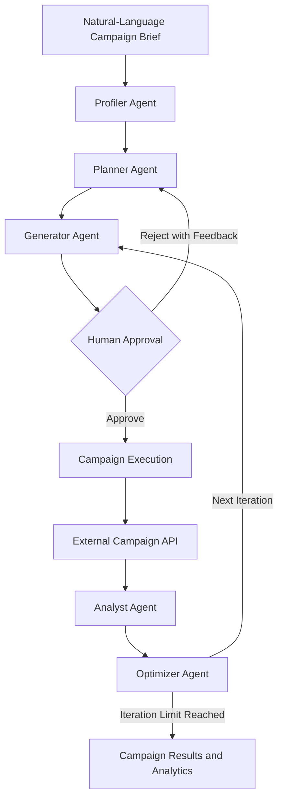

# 🚀 Market Makers AI

**An AI-powered marketing campaign orchestration platform built with multi-agent intelligence, human-in-the-loop approval, and performance-driven optimization.**

Market Makers AI transforms natural-language marketing briefs into structured campaign strategies, audience segments, personalized content variants, and measurable execution workflows.

Powered by a five-agent LangGraph architecture, the platform coordinates audience profiling, strategic planning, creative generation, performance analysis, and campaign optimization—with human approval before deployment.

---

## 📐 Strategic Architecture

The platform uses a graph-based workflow to coordinate specialized AI agents, manage campaign state, and connect human review with campaign execution.



### Strategic Agent Command

| Agent | Domain | Responsibility |
|---|---|---|
| **Profiler Agent** | Audience Intelligence | Retrieves and enriches customer cohort information for targeting |
| **Planner Agent** | Campaign Strategy | Develops audience segments, campaign strategies, and A/B variants |
| **Generator Agent** | Creative Engineering | Generates campaign content and heuristic performance predictions |
| **Analyst Agent** | Performance Intelligence | Processes campaign metrics, including opens and clicks |
| **Optimizer Agent** | Growth Optimization | Uses campaign performance observations to inform subsequent iterations |

The agents coordinate through shared workflow state and conditional transitions, enabling a structured campaign lifecycle instead of isolated AI calls.

---

## ✨ Key Features

### 🧠 Multi-Agent AI Orchestration
- Five specialized agents coordinated through LangGraph.
- Structured state management across campaign stages.
- Conditional workflow transitions based on approval and execution status.
- Iterative campaign generation and optimization.

### 🎯 Intelligent Audience Profiling
- Retrieves customer cohort information through backend integrations.
- Supports audience segmentation as part of campaign planning.
- Connects customer insights to downstream campaign generation.

### ✍️ AI-Powered Campaign Generation
- Accepts natural-language marketing briefs.
- Generates campaign strategies and personalized content variants.
- Supports A/B campaign variants.
- Produces heuristic performance predictions.

### 🛡️ Human-in-the-Loop Approval
- Pauses campaigns for human review before execution.
- Supports campaign approval and rejection.
- Allows reviewers to provide feedback on rejected campaigns.
- Connects review decisions to subsequent workflow transitions.

### 📊 Campaign Analytics
- Tracks recipient counts, opens, clicks, and engagement rates where data is available.
- Provides campaign-specific metrics through backend APIs.
- Supports cached metrics and optional live refreshes.
- Visualizes campaign performance through dashboard components.

### 🔄 Iterative Optimization
- Analyzes observed campaign performance.
- Uses analytical results to inform subsequent campaign iterations.
- Enforces a configured maximum of three optimization iterations.

### 📋 Campaign Tracking
- Persists campaign and workflow information in PostgreSQL.
- Provides endpoints for campaign retrieval and status monitoring.
- Records agent execution logs and associated campaign details.

### 📡 API Usage Monitoring
- Exposes external API quota analytics.
- Tracks API usage through the backend analytics layer.
- Helps developers monitor service limits and request consumption.

---

## 🛠️ Technology Stack

| Layer | Technologies |
|---|---|
| Frontend | React, Vite, JavaScript |
| UI and Styling | Tailwind CSS, Framer Motion, Lucide React |
| Routing | React Router |
| Data Visualization | Recharts |
| HTTP Client | Axios |
| Backend | Python, FastAPI, Uvicorn |
| AI Orchestration | LangGraph, LangChain |
| Model Integrations | LangChain OpenAI and Ollama integrations |
| Database | PostgreSQL |
| ORM | SQLAlchemy |
| Database Migrations | Alembic |
| Configuration | Pydantic Settings, python-dotenv |
| Containerization | Docker, Docker Compose |
| Deployment Configuration | Render, Netlify |

---

## 🏗️ Project Structure

```text
Market-Makers--AI/
├── backend/
│   ├── agents/
│   │   ├── profiler.py
│   │   ├── planner.py
│   │   ├── generator.py
│   │   ├── analyst.py
│   │   └── optimizer.py
│   ├── api/
│   │   ├── campaigns.py
│   │   ├── approval.py
│   │   └── analytics.py
│   ├── db/
│   │   ├── database.py
│   │   └── models.py
│   ├── tools/
│   ├── workflows/
│   │   ├── langgraph_flow.py
│   │   └── state.py
│   ├── main.py
│   └── requirements.txt
├── frontend/
│   ├── src/
│   │   ├── components/
│   │   ├── pages/
│   │   ├── services/
│   │   ├── App.jsx
│   │   └── main.jsx
│   ├── package.json
│   └── vite.config.js
├── docker-compose.yml
├── render.yaml
├── netlify.toml
├── test_flow.sh
└── README.md
```

---

## ⚡ Getting Started

### Prerequisites

Ensure the following tools and services are available:

- Docker and Docker Compose
- Python 3.11 or a compatible Python version
- Node.js and npm
- PostgreSQL, if running the database separately
- Required external campaign API credentials
- Credentials and configuration for the selected AI model provider

### 1. Clone the Repository

```bash
git clone https://github.com/AdiTYa-SiNgh-tech/Market-Makers--AI.git
cd Market-Makers--AI
```

### 2. Configure Environment Variables

Create a `.env` file in the project root and configure the database and external campaign API settings.

```env
POSTGRES_USER=your_database_user
POSTGRES_PASSWORD=your_database_password
POSTGRES_DB=your_database_name
POSTGRES_HOST=localhost
POSTGRES_PORT=5432

HACKATHON_API_KEY=your_campaign_api_key
HACKATHON_TEAM_NAME=your_team_name
HACKATHON_TEAM_EMAIL=your_team_email
```

Configure additional AI model settings as required by the backend implementation.

**Security:** Never commit actual API keys, database passwords, or other secrets to GitHub.

### 3. Start with Docker Compose

Build and start the application:

```bash
docker compose up --build -d
```

Check the running containers:

```bash
docker compose ps
```

View application logs:

```bash
docker compose logs -f
```

Ensure the required environment variables and services are configured before launching the application.

### 4. Run the Backend Separately

Navigate to the backend directory:

```bash
cd backend
python -m venv .venv
```

Activate the virtual environment.

**Windows PowerShell:**

```powershell
.venv\Scripts\Activate.ps1
```

**Linux/macOS:**

```bash
source .venv/bin/activate
```

Install dependencies and start the API:

```bash
pip install -r requirements.txt
uvicorn main:app --reload --host 0.0.0.0 --port 8000
```

### 5. Run the Frontend Separately

Open another terminal:

```bash
cd frontend
npm install
npm run dev
```

Open the frontend at:

http://localhost:5173

Ensure the frontend API configuration points to the backend URL.

---

## 🌐 Application Access

| Module | URL | Description |
|---|---|---|
| **Market Makers AI Studio** | [http://localhost:5173](http://localhost:5173) | Campaign creation and review interface |
| **Analytics Dashboard** | [http://localhost:5173/dashboard](http://localhost:5173/dashboard) | Campaign performance and orchestration status |
| **Settings** | [http://localhost:5173/settings](http://localhost:5173/settings) | Application configuration interface |
| **API Documentation** | [http://localhost:8000/docs](http://localhost:8000/docs) | Interactive REST API documentation |
| **Health Check** | [http://localhost:8000/health](http://localhost:8000/health) | Backend health endpoint |

These addresses assume the services are running locally on the configured ports.

---

## 🔌 API Reference

The FastAPI backend exposes endpoints for campaign generation, status retrieval, approval, rejection, analytics, and optimization.

| Method | Endpoint | Purpose |
|---|---|---|
| `GET` | `/health` | Check backend health |
| `POST` | `/api/campaigns/generate` | Generate a campaign |
| `GET` | `/api/campaigns` | Retrieve recent campaigns |
| `GET` | `/api/campaigns/{id}/status` | Retrieve campaign status and details |
| `GET` | `/api/campaigns/{id}/status-summary` | Retrieve a campaign status summary |
| `POST` | `/api/campaigns/{id}/approve` | Approve a pending campaign |
| `POST` | `/api/campaigns/{id}/reject` | Reject a campaign with optional feedback |
| `GET` | `/api/campaigns/{id}/metrics` | Retrieve campaign performance metrics |
| `POST` | `/api/campaigns/{id}/optimize` | Trigger campaign optimization |
| `GET` | `/api/analytics/quota` | Retrieve API quota analytics |

For request parameters, schemas, and response formats, open the interactive API documentation at `/docs`.

---

## 🧪 Testing

The repository includes an end-to-end shell script for exercising the campaign lifecycle.

Ensure the backend, database, external API credentials, and required services are configured before running the test.

**Linux/macOS or WSL:**

```bash
chmod +x test_flow.sh
./test_flow.sh
```

The script attempts to:

1. Generate a campaign.
2. Poll the campaign status.
3. Approve the campaign.
4. Wait for execution or monitoring.
5. Trigger campaign optimization.

The complete workflow depends on the availability of external APIs, valid credentials, and correctly configured services.

---

## 🔐 Reliability and Design Considerations

- **Workflow orchestration:** LangGraph manages agent sequencing and conditional transitions.
- **Human oversight:** Campaign approval is required before deployment.
- **Persistent state:** PostgreSQL stores campaign and workflow information.
- **External integrations:** Campaign execution and metric retrieval depend on configured services.
- **Observability:** API endpoints expose campaign status, metrics, and execution logs.
- **Bounded optimization:** The configured iteration limit prevents unbounded optimization loops.

---

## 🗺️ Roadmap

- [ ] Expand unit and integration testing for agent behavior.
- [ ] Improve retries and recovery for external API failures.
- [ ] Strengthen authentication and role-based access control.
- [ ] Enhance campaign attribution and A/B testing analysis.
- [ ] Add reproducible evaluations of optimization strategies.
- [ ] Improve structured logging and production monitoring.
- [ ] Expand deployment and configuration documentation.

---


If you find this project useful, consider giving the repository a ⭐ on GitHub.
